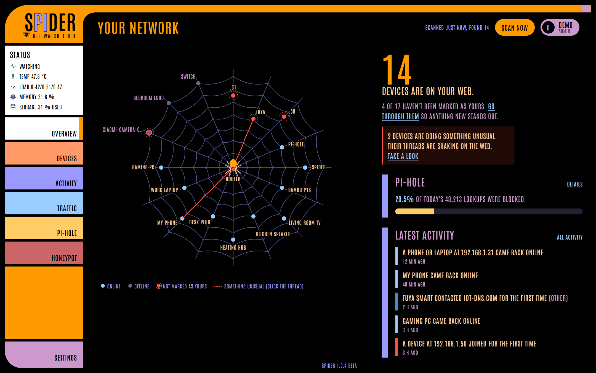
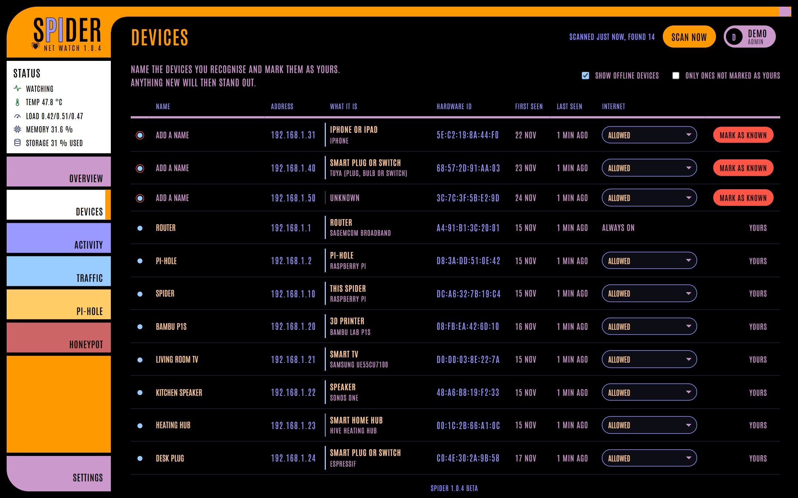
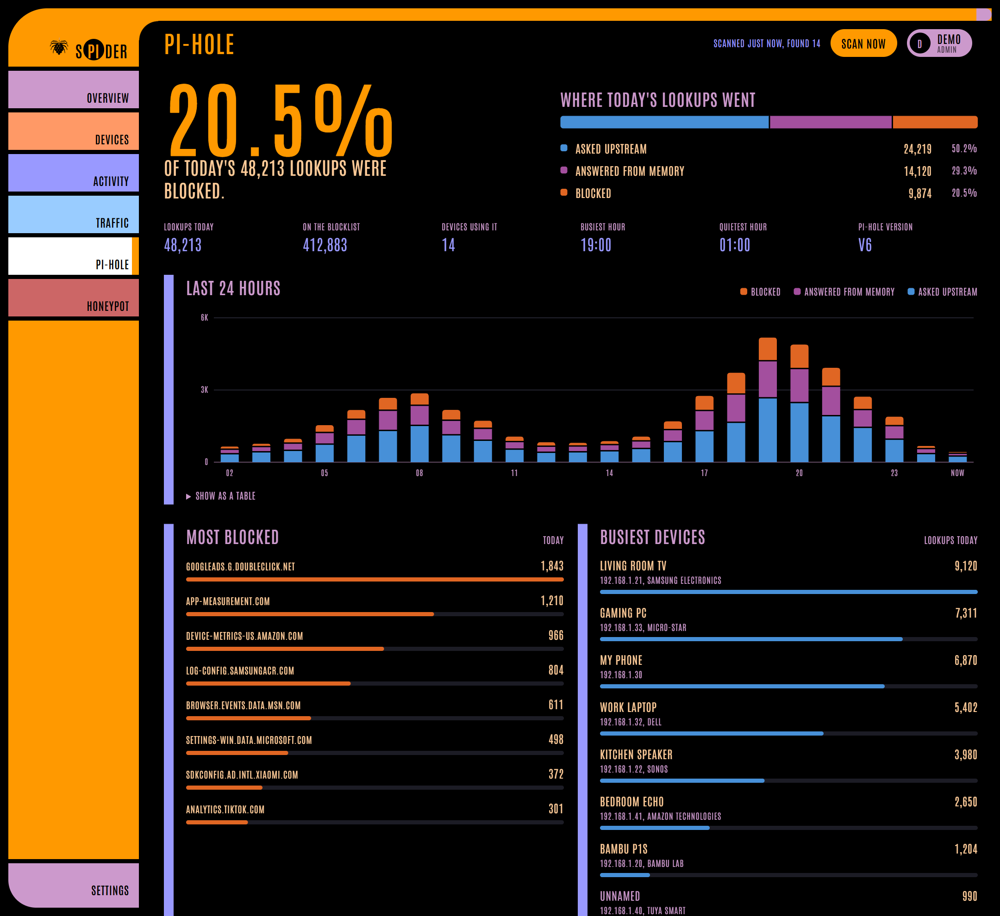
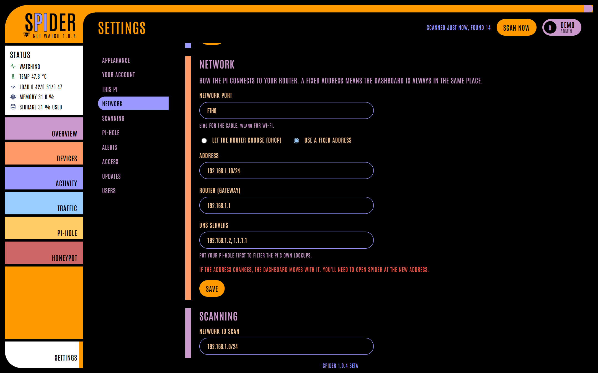
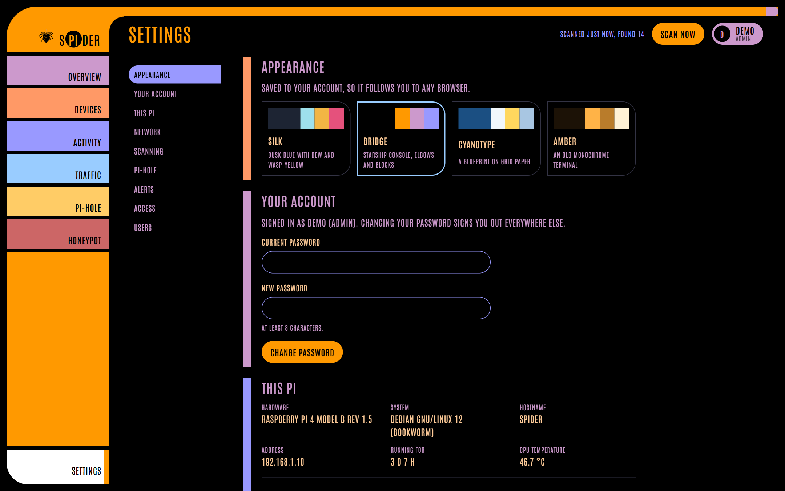
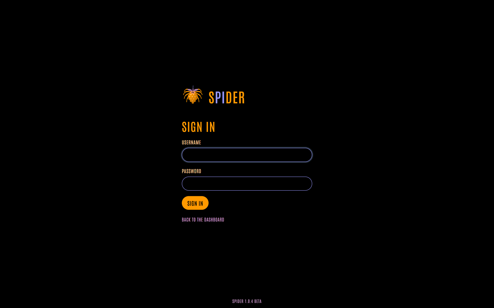
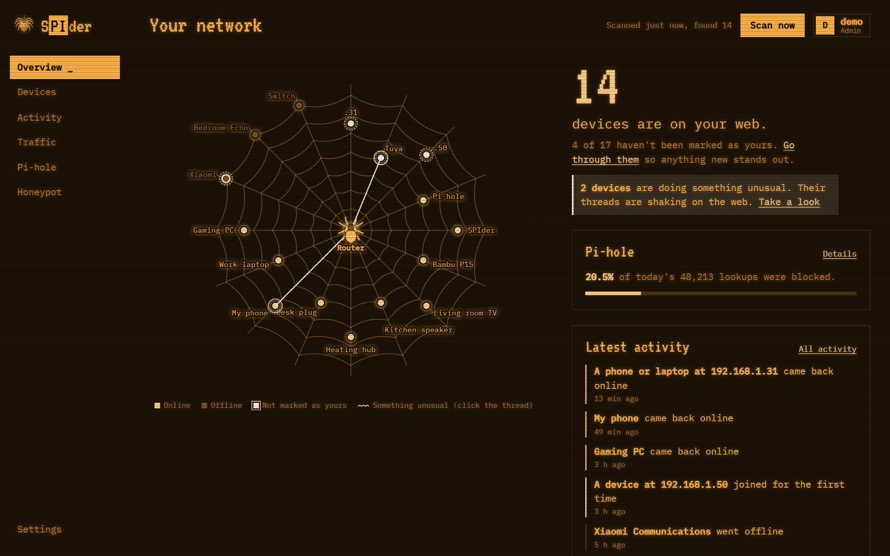

# SPIder

**A Raspberry Pi home network watchtower and honeypot.** Like a spider in its web, it feels every vibration on your network: every device that joins, every one that leaves, and anything that wanders into the honeypot.

> The name: a spider watches its web, and **SPI** is one of the Raspberry Pi's hardware buses.

Runs happily on a Raspberry Pi 4 (2 GB or more), but works on any Linux, macOS or Windows machine too.



## Screenshots

All screenshots use made-up demo data (see [Try the demo](#try-the-demo)).

| | |
|---|---|
|  |  |
| **Devices.** Name what you recognise; strangers float to the top. | **Activity.** Everything that happened, day by day. |
|  |  |
| **Traffic.** What every device talks to, and the first contacts worth a look. | **One device.** An unidentified smart plug that started calling a new server. |
|  |  |
| **Pi-hole.** Today's blocking, the last 24 hours, and who's asking most. | **Settings.** The Pi's hostname, network, scanning and more. |
|  |  |
| **Themes.** Four of them, saved to your account. | **Accounts.** Admins change things; viewers just look. |

<p align="center">
  
  &nbsp;&nbsp;
  
</p>

### The other themes

| Silk | Cyanotype | Amber |
|---|---|---|
|  |  |  |

## Features

### Watchtower (working now)
- Discovers every device on your LAN using ARP, so it works behind any router, including ISP ones
- Looks up each device's maker from its MAC address, entirely offline
- Spots phones and laptops that use private (randomised) MAC addresses
- Alerts on new devices, optionally by push notification to your phone via [ntfy](https://ntfy.sh)
- Online/offline history and IP-change tracking
- Lets you name devices and mark them as known, so strangers stand out

### Knows what each device is
Not just "Tuya" or "Samsung": SPIder works out **what** each device is (a smart plug, a Samsung TV, an iPad, a Bambu P1S, a Windows PC...) and shows **how it knows**, with a confidence level. Admins can correct it, and SPIder remembers. Clues come from:

- **Its own announcement (DHCP):** devices broadcast their name (and often Android/Windows/Linux) when they join. SPIder just listens
- **Bonjour (mDNS):** Chromecasts give their model and room, printers their model, HomeKit gear its category, iPhones and Macs their model code
- **UPnP:** TVs, speakers and routers describe their make, model and friendly name
- **Bambu Lab printers** announce their model and name
- **A light port check,** once a day per device: e.g. Tuya's local port, RTSP cameras, printers, Apple's sync port, Remote Desktop, plus a web page title if there is one
- **The maker** from the hardware ID, using Wireshark's up-to-date list (refreshed weekly), and **Pi-hole's** device names when connected

Everything stays on your network; only the weekly maker-list download reaches the internet.

### Pi-hole stats (working now)
- Shows how much was blocked today, where lookups went (blocked, cached, upstream), a 24-hour chart, the most-blocked domains and your busiest devices, using SPIder's own device names
- Supports Pi-hole **v6** (REST API) and **v5** (api.php)

### Traffic (with a Pi-hole connected)
- What each **device** talks to: sites, kinds of use (streaming, gaming, smart home, work…) and when it's busy
- **First contacts:** after a day learning what's normal for a device, SPIder flags any place it contacts for the first time, like a smart plug that suddenly starts calling a new cloud server. Optional phone alerts
- Ads and trackers are left to Pi-hole. SPIder only looks at lookups Pi-hole allowed, and keeps 30 days of its own history

### Pause a device (with Pi-hole v6)
- An **Internet** menu on every device: pause for 30 minutes, 1 or 2 hours, until 7am, or block until you unblock it. Pauses lift themselves
- Works through a "SPIder paused" group in Pi-hole that answers nothing. SPIder checks that rule can only ever affect paused devices, and refuses (and cleans up) if it can't be sure
- The router, your Pi-hole and SPIder itself can't be paused. It's DNS-level: great for "the Switch is off until morning", not a firewall

### Dashboard
- A live spider-web map of your network, plus separate pages for Devices, Activity, Pi-hole and Honeypot
- Four themes: **Silk**, **Bridge** (starship console), **Cyanotype** (blueprint) and **Amber** (CRT terminal), saved per account
- Accounts with **admin** and **viewer** roles. The first visit asks you to create the admin
- Guests can look without signing in (you can switch this off). Any change needs an admin

### Settings page
- The Pi: display name, hostname, timezone and live system info (model, OS, CPU temperature, uptime)
- Network: DHCP or a fixed address, gateway and DNS
- Scanning, Pi-hole, phone alerts (with a test button) and user management
- Hostname, timezone and network changes are applied to the Pi when `SPIDER_ALLOW_SYSTEM_CHANGES=true` and SPIder runs on the Pi as root. Otherwise SPIder shows the exact commands to run

### Honeypot
- Fake doors on your LAN that nothing in your home should ever use: FTP 21, Telnet 23, SSH 2222, Windows file sharing 445, Remote Desktop 3389 and a router-style login page on 8081 (change them in Settings)
- Anything that knocks is recorded: who it was, which door, and the usernames and passwords it tried. Then the connection is dropped. Nothing a visitor sends is ever run
- A device you've marked as known gets a red warning (it may be infected); one trying 3 or more doors is flagged as scanning
- Alerts on the Honeypot page, in the status panel, in Activity and through ntfy, plus one-click Block in Pi-hole
- Only faces your own network: nothing is opened on your router

## Quick start (any PC, for development)

```bash
python -m venv .venv
# Windows:  .venv\Scripts\activate
# Linux/Mac: source .venv/bin/activate
pip install -r requirements.txt
cp .env.example .env        # optional, edit to taste
python -m spider
```

Then open <http://localhost:8080>.

> On Windows without [Npcap](https://npcap.com), and on Linux without root, SPIder automatically falls back to a ping sweep plus the OS ARP table. It's slower but needs no special permissions. The status line shows which method was used.

## Try the demo

See everything working without a Pi-hole or a real network scan:

```bash
python scripts/demo/run.py
```

Open <http://127.0.0.1:8090> and sign in as `demo` / `demo-password` (admin) or `guest` / `guest-password` (viewer). The demo has its own made-up devices, history and a stand-in Pi-hole, keeps its data in `data-demo/` (fresh each run), shows a **Demo** badge, and never scans your network. Your real SPIder is untouched.

To regenerate the README screenshots: `pip install -r requirements-dev.txt`, then `python scripts/screenshots.py` (uses Edge or Chrome).

## Running on a Raspberry Pi

1. Flash **Raspberry Pi OS Lite (64-bit)** and enable SSH.
2. Install Docker:
   ```bash
   curl -fsSL https://get.docker.com | sh
   sudo usermod -aG docker $USER   # log out and back in
   ```
3. Clone and start:
   ```bash
   git clone https://github.com/zolartuc/SPIder.git
   cd SPIder
   cp .env.example .env && nano .env
   docker compose up -d --build
   ```
4. Open `http://<pi-ip>:8080`.

Give the Pi a **fixed IP address** (a DHCP reservation in your router) so you can always find the dashboard.

### With Portainer

`portainer-stack.yml` builds SPIder on the Pi straight from this repository and keeps its data in a named volume, so updates never wipe it.

1. **If the repository is private,** create a GitHub token for Portainer: GitHub > Settings > Developer settings > Personal access tokens > **Fine-grained tokens** > Generate new token.
   - Repository access: **Only select repositories**, then pick this one
   - Permissions: **Contents: Read-only** (Metadata: Read-only is added automatically). Nothing else
2. In Portainer: **Stacks > Add stack**, name it `spider`, choose **Repository**:
   - Repository URL: `https://github.com/zolartuc/SPIder`
   - Repository reference: `refs/heads/main`
   - Compose path: `portainer-stack.yml`
   - Authentication: on. Username: your GitHub username. Personal access token: the token from step 1
3. Optional environment variables: `SPIDER_PORT` (default `8080`), `TZ` (default `Europe/London`), `SPIDER_PIHOLE_URL`, `SPIDER_PIHOLE_PASSWORD`, `SPIDER_NTFY_TOPIC`. You can also set these later on SPIder's Settings page.
4. **Deploy the stack.** The first build takes a few minutes on a Pi 4. Then open `http://<pi-ip>:8080` and create your admin account.

### Updates

The footer of every page shows the version SPIder is running (for example `SPIder 1.0.0 Beta`), and an **Update available** badge when GitHub has a newer version (checked every 6 hours, or from **Settings > Updates > Check for updates**).

Versions go up by 0.0.1 with every release pushed here, and each release is tagged (`v1.0.0`, `v1.0.1`, ...).

**Update now** (admins) updates SPIder in place: it downloads the newest build from GitHub, checks it against GitHub's fingerprint for that build, test-loads it, installs any new libraries, then swaps it in and restarts. Your data isn't touched, and the previous build is kept as `spider.previous`. It takes about a minute. While it runs, SPIder spins a web on screen, one ring per step, and reloads the page once it's back. In demo mode, Update now runs a pretend update so you can see it, and changes nothing.

- Changes to the Docker setup itself (rare) still need **Pull and redeploy** in Portainer.
- For a private copy of SPIder, add a read-only GitHub token under **Settings > Updates > Advanced**. If SPIder can't update itself, a Portainer webhook there lets **Update now** ask Portainer to redeploy instead.

## Configuration

Settings live in `.env`; see [`.env.example`](.env.example) for all of them.

| Setting | Default | What it does |
|---|---|---|
| `SPIDER_SUBNET` | auto | Subnet to scan, e.g. `192.168.1.0/24` |
| `SPIDER_SCAN_INTERVAL` | `300` | Seconds between scans |
| `SPIDER_SCAN_METHOD` | `auto` | `arp`, `ping` or `auto` |
| `SPIDER_OFFLINE_AFTER_MINUTES` | `15` | How long before a silent device counts as offline |
| `SPIDER_NTFY_TOPIC` | – | ntfy topic for push alerts (pick something unguessable) |
| `SPIDER_PIHOLE_URL` | – | e.g. `http://192.168.1.2` |
| `SPIDER_PIHOLE_PASSWORD` | – | v6: an app password. v5: the API token |

### Pi-hole setup
- **v6:** In the Pi-hole web UI, go to *Settings → Web interface / API → Configure app password*, and put that password in `SPIDER_PIHOLE_PASSWORD`.
- **v5:** Go to *Settings → API → Show API token*.

## Security notes
- Passwords are hashed with scrypt. Sessions are random server-side tokens in an HttpOnly, SameSite=Strict cookie. Sign-in is throttled after 5 wrong passwords.
- The dashboard runs over plain HTTP, so keep it on your LAN and never port-forward it.
- There's no password-reset email. If you lose the admin password, delete the `users` table rows in `data/spider.db` to run the first-time setup again.
- Device hostnames are treated as untrusted input and escaped before display.

## Roadmap

- [x] Device discovery, vendor lookup and new-device alerts
- [x] Pi-hole stats
- [x] Accounts, roles and a Settings page
- [x] Separate pages and four themes
- [x] **Honeypot, phase 1 (internal canary):** fake SSH, Telnet and web login on the LAN. Any connection means something on your network is scanning, which deserves an instant alert
- [x] Honeypot: record attempted usernames and passwords
- [ ] Per-device open-port scan ("what is this smart plug listening on?")
- [ ] Pi-hole: top blocked domains, and queries per device matched to the device list
- [ ] Device online/offline timeline chart
- [ ] **Honeypot, phase 2 (internet-facing):** run on an isolated VLAN or a cheap VPS, with an attacker world map
- [ ] Bambu Lab printer module (MQTT status and camera)

## License

MIT
